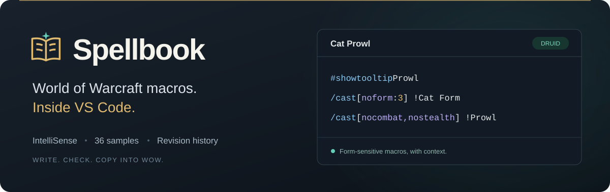
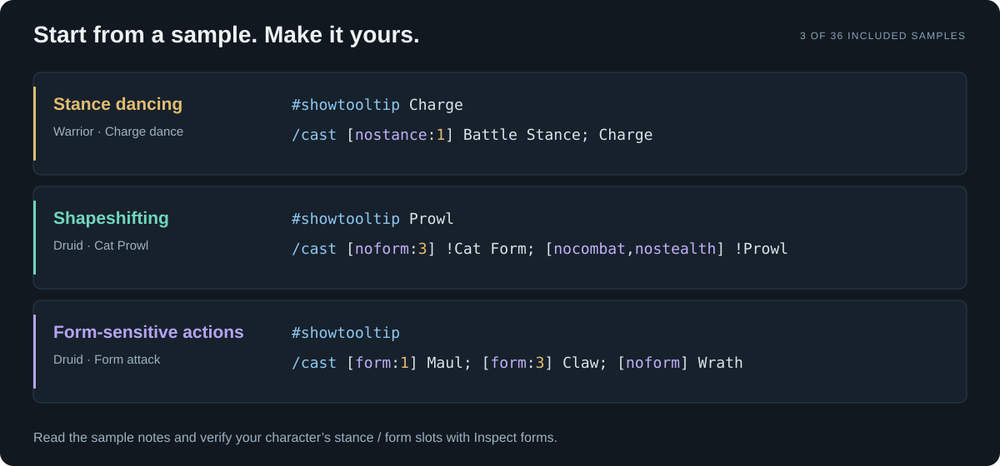

# Spellbook

A World of Warcraft macro IDE inside **VS Code**. Write macros with highlighting, IntelliSense, inline Lua, and live diagnostics. Keep a personal library and start from 36 guided samples for stance dancing, shapeshifting, form-sensitive actions, and targeting.

**[Download the VS Code extension](https://github.com/krflol/Spellbook/releases/tag/v0.2.0)** · [Extension guide](extension/README.md) · [Language reference](extension/docs/REFERENCE.md) · [Report an issue](https://github.com/krflol/Spellbook/issues)

## Get started

1. Download `spellbook-0.2.0.vsix` from Releases.
2. In VS Code, run **Extensions: Install from VSIX…** and select it.
3. Click the Spellbook book icon in the Activity Bar, or run **Spellbook: New Macro from Sample**.
4. Edit, then **Copy Macro for WoW** and paste into the game's macro editor.

VS Code 1.96+ on desktop is required. The extension is distributed as a universal VSIX through GitHub Releases; it is not currently on the Marketplace.

## Autocomplete in context


*Illustrated walkthrough using Spellbook's actual completion results and character counter.*

## Features

- Native VS Code tabs, split editors, themes, keyboard shortcuts, multi-cursor editing, find/replace, undo/redo, and Outline.
- WoW command, condition, target, and inline Lua highlighting; contextual completion, hover reference, quick fixes, and Problems.
- Character and UTF-8 byte budgets that preserve oversized drafts.
- Local macro library with autosave, search, class filters, favorites, character labels, tags, Markdown notes, and recoverable Trash.
- The last 100 content revisions per macro, native comparisons, and revision restoration.
- 36 samples and snippets, including stance dancing, Bear/Cat switching, travel forms, Prowl, powershifting, caster healing, form-sensitive attacks, mouseovers, and focus.
- `.wowmacro` / `.macro` files, Atlas and Spellbook desktop library imports, JSON/text exports, and custom autocomplete catalogues.



*Three of the 36 included samples. Each comes with guidance about keypress behavior, requirements, and form slots.*

The extension makes no network requests, collects no telemetry, and does not execute macros or modify the game. The samples and bundled English vocabulary focus on **WoW Forever / Classic-style mechanics**. Verify spell availability and form slots on your character; samples have not been tested in a live game session. Diagnostics check structure rather than simulating gameplay or compiling Lua.

## Migrate from desktop or Atlas

Export your library as JSON from the desktop app or Forever Atlas, then run **Spellbook: Import Macros / Atlas Library** in VS Code. Macro text and metadata are preserved. Desktop databases remain separate; history is not included in portable library exports.

The [original desktop app](docs/DESKTOP.md) and its [v0.1.0 Windows release](https://github.com/krflol/Spellbook/releases/tag/v0.1.0) remain available.

## Develop the extension

Use Node.js 22 or newer:

```sh
cd extension
npm ci
npm run check:data
npm run format:check
npm test
npm run test:host
npm run package
```

On a headless Linux machine, run `xvfb-run -a npm run test:host`. The test runner creates isolated VS Code profiles, leaving your usual extensions, settings, and library untouched. Set `SPELLBOOK_VSCODE_EXECUTABLE` to an existing VS Code executable to avoid downloading a test host.

The generated VSIX and checksums are written to `dist/`. To debug, open this repository in VS Code and use **Run Spellbook Extension** from Run and Debug (F5).

The extension uses TypeScript and native VS Code language, tree, file system, and diff APIs. It has no runtime package dependencies. Shared sample/reference data is generated from `src/macros/` and `assets/names.txt`; run `npm run generate` after editing those sources. See [release notes](CHANGELOG.md).

## License

MIT; see [LICENSE](LICENSE). Independent community software, not affiliated with or endorsed by Blizzard Entertainment. World of Warcraft is a Blizzard trademark. No Blizzard artwork or client database is included. Desktop dependencies are listed in [third-party notices](THIRD_PARTY_NOTICES.txt).
