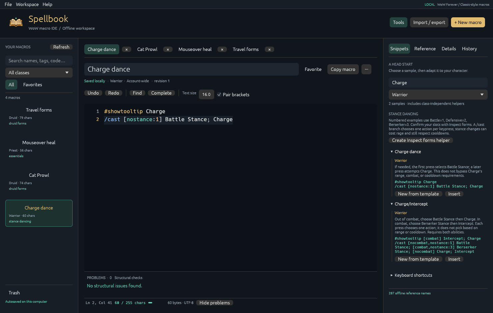
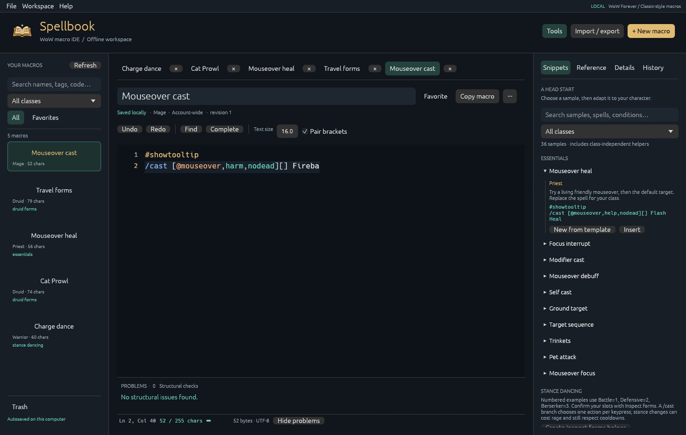

<p align="center"></p>

# Spellbook

A native, offline IDE for World of Warcraft macros. Write with syntax highlighting and autocomplete, keep a personal library, and start from practical stance, shapeshift, and targeting samples.

**[Download for Windows](https://github.com/krflol/Spellbook/releases/latest)** · [User guide](docs/GUIDE.md) · [Autocomplete catalogues](docs/CATALOGUES.md) · [Report an issue](https://github.com/krflol/Spellbook/issues)



## Get started

Download `Spellbook-0.1.0-windows-x64.zip` from Releases, extract it, and open `spellbook.exe`. No installer, account, Atlas database, or game installation is needed. The Windows release is unsigned.

Create a macro or pick a sample, edit it, then use **Copy macro** and paste into WoW's macro editor. Spellbook saves drafts locally; it does not execute macros or modify the game.

## In the editor

- WoW command, conditional, target, and inline Lua syntax highlighting.
- Contextual completion for commands, conditions, APIs, and bundled spell/item names. Import custom catalogues for your client or locale.
- Multiple tabs, line numbers, bracket matching and pairing, hover reference, undo/redo, find/replace, go to line, and duplicate line.
- Live structural problems, clickable diagnostics, and separate character/UTF-8 byte budgets.
- Searchable macro library with favorites, class/character labels, tags, notes, recoverable trash, and revision history.
- Autosave with concurrent-edit protection, restored tabs/cursors/editor settings, and native import/export dialogs. Drop text or JSON files onto the window to import.
- 36 searchable samples: stance dancing, Bear/Cat switching, travel forms, Prowl, powershifting, caster healing, form-sensitive attacks, stealth, mouseovers, focus, modifiers, and utilities.



The samples and bundled English vocabulary focus on **WoW Forever / Classic-style mechanics**. Learned form slots and spell availability vary; the **Inspect forms** sample helps you verify your character's slots. Structural checks are not a Lua compiler or gameplay simulator, and these samples have not been validated in a live game session.

## Local data and portability

On Windows, data lives in `%LOCALAPPDATA%\Spellbook`. Use `spellbook.exe --portable` to keep a `data` folder beside the executable, or `--data-dir PATH` to choose a location. Libraries exported from Forever Atlas can be imported directly. Spellbook library exports are also supported by the updated Atlas macro tab.

No telemetry, automatic updates, or remote requests. Documentation links open in your browser only when clicked.

## Build and contribute

Install Rust 1.95 or newer and the platform's native compiler tools. Windows builds require the Visual Studio C++ build tools and Windows SDK.

```sh
cargo run --locked
cargo test --locked --all-targets
cargo clippy --locked --all-targets -- -D warnings
cargo fmt --all -- --check
cargo build --locked --release
```

On Windows, `powershell -File scripts/package.ps1` builds a versioned zip and SHA-256 checksums in `dist/`. Windows x64 is the tested release platform; macOS/Linux source builds are not validated in this release.

The app uses Rust, egui/eframe, and SQLite. It originated in Forever Atlas and now runs independently. See [architecture](docs/ARCHITECTURE.md), [visual design](docs/design/README.md), and [release notes](CHANGELOG.md).

## License

MIT; see [LICENSE](LICENSE) and [third-party notices](THIRD_PARTY_NOTICES.txt). Spellbook is independent community software, not affiliated with or endorsed by Blizzard Entertainment. World of Warcraft is a Blizzard trademark. No Blizzard artwork or client database is included.
