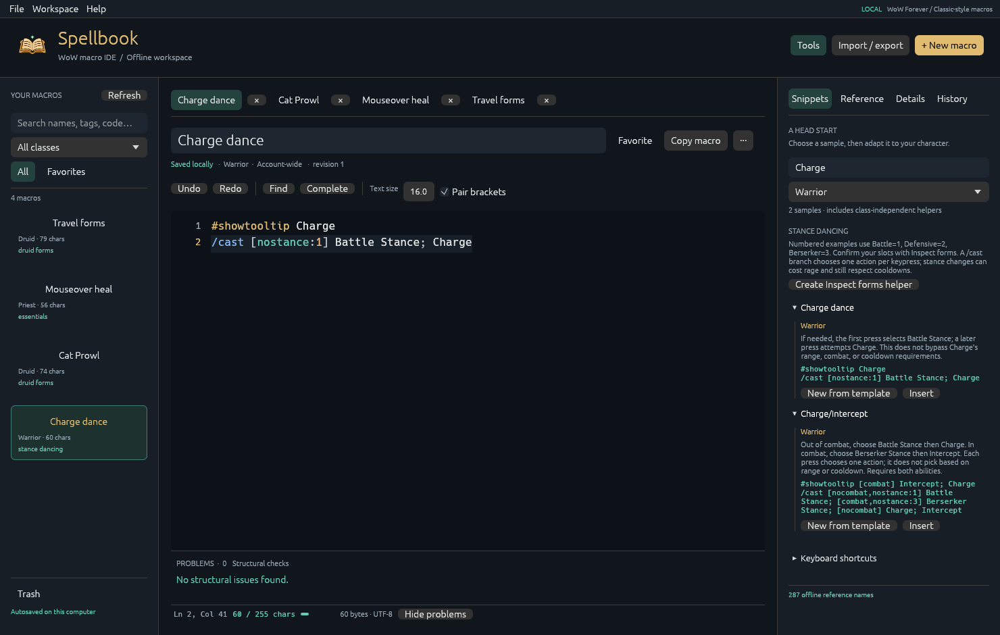

# Spellbook desktop

The original Rust/egui desktop app remains in this repository. [Download v0.1.0 for Windows](https://github.com/krflol/Spellbook/releases/tag/v0.1.0), extract the zip, and open `spellbook.exe`.



See the [desktop user guide](GUIDE.md), [catalogue format](CATALOGUES.md), [architecture](ARCHITECTURE.md), and [visual design](design/README.md).

Data lives in `%LOCALAPPDATA%\Spellbook`. Use `--portable` for a `data` folder beside the executable or `--data-dir PATH` for a chosen location. To migrate to the [VS Code extension](../extension/README.md), export a library JSON file and import it using **Spellbook: Import Macros / Atlas Library**.

Build with Rust 1.95+ and the platform's native compiler tools:

```sh
cargo run --locked
cargo test --locked --all-targets
cargo clippy --locked --all-targets -- -D warnings
cargo fmt --all -- --check
cargo build --locked --release
```

On Windows, `powershell -File scripts/package.ps1` builds the desktop zip. The desktop release workflow remains separate from extension packaging.
