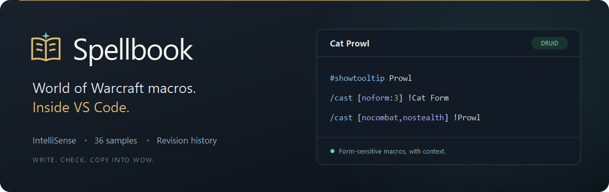
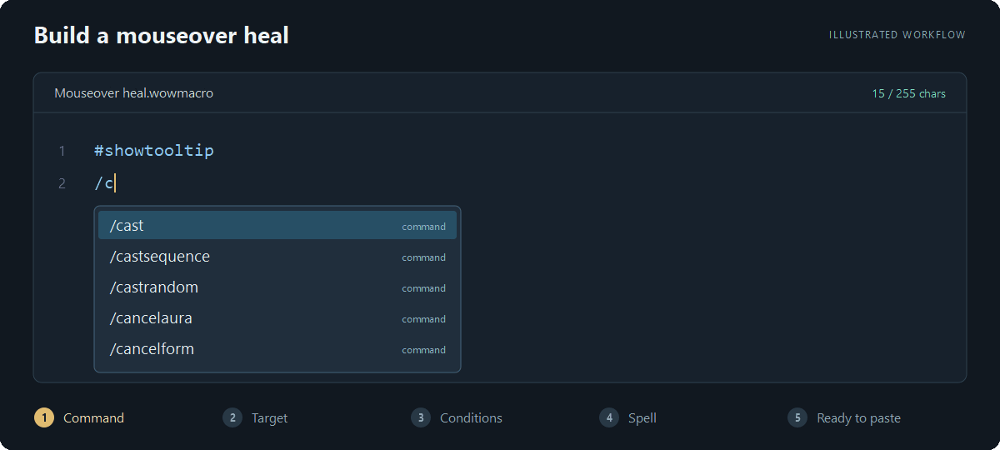
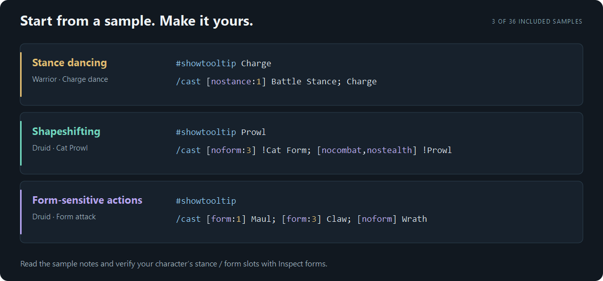

# Spellbook — WoW Macro IDE



Write World of Warcraft macros in VS Code, with contextual IntelliSense, syntax highlighting, inline Lua support, and a local macro library. Includes 36 practical samples for stance dancing, shapeshifting, form-sensitive actions, targeting, and modifiers.

## Install

1. Download `spellbook-0.2.0.vsix` from [GitHub Releases](https://github.com/krflol/Spellbook/releases/tag/v0.2.0).
2. In VS Code, run **Extensions: Install from VSIX…** from the Command Palette and select the file.
3. Open **Spellbook** using the book icon in the Activity Bar, or run **Spellbook: New Macro from Sample**.

Requires desktop VS Code 1.96 or newer. The VSIX is platform-independent and contains no native runtime dependencies. This release is distributed through GitHub; it is not published on the Visual Studio Marketplace.

## Write and organize

- **Native editor:** tabs, split views, find/replace, multi-cursor editing, undo/redo, bracket matching, Outline, and your existing theme and keybindings.
- **WoW language support:** slash commands, directives, conditionals, targets, spell/item names, hover reference, quick fixes, and Lua highlighting inside `/run` and `/script`.
- **Live feedback:** structural errors appear in Problems. The status bar shows the character budget; its tooltip shows UTF-8 bytes. Drafts over the limit are preserved.
- **Macro Library:** search, class filters, favorites, character labels, tags, Markdown notes, duplication, and recoverable Trash.
- **Revision History:** the last 100 content revisions per macro, native side-by-side comparisons, and restore without losing the current version.
- **Samples:** inspect guidance, create an editable library copy, or insert a sample into the current editor. Type `sb-` for native snippets.
- **Files:** `.wowmacro` and `.macro` files work directly in the editor. Use **Spellbook: Save Current Macro to Library** when you want library management.



*Illustrated walkthrough using Spellbook's actual completion results and character counter.*

Library macros and notes autosave after a one-second typing pause; Ctrl+S / Cmd+S saves immediately. Ordinary files follow VS Code's Auto Save setting. Cross-window revision checks prevent an older draft from overwriting newer library content. If a conflict occurs, the editor retains your draft; use Save As or Duplicate Macro to preserve it before reloading.

Use **Spellbook: Edit Macro Details → Notes** to edit a macro's notes. Right-click a macro for organization, export, and history actions. Click a saved revision to compare it with the current macro, or use its restore action to create a new revision from it.

## Use a macro in WoW

Run **Spellbook: Copy Macro for WoW**, click the editor's copy icon, or press **Ctrl+Alt+C** (**Cmd+Alt+C** on macOS). Paste into the game's macro editor. Spellbook does not execute macros or write to the game.

The bundled examples and English vocabulary focus on **WoW Forever / Classic-style mechanics**. Spell availability and stance/form slots depend on your client and character. Read each sample's guidance and use **Inspect forms** to check your slots. Samples have not been tested in a live game session. Diagnostics check structure; they are not a Lua compiler or a gameplay simulator.



## Bring your library

Use **Spellbook: Import Macros / Atlas Library** for plain macro files or JSON exported from Spellbook desktop / Forever Atlas. Names, bodies, class/character labels, tags, notes, and favorites are preserved. Each imported file is validated before its macros are added. Imports create copies; they do not replace existing macros.

Use **Spellbook: Export Macro Library** for a portable JSON backup, or **Export Macro as File** for `.wowmacro` text. Library exports include active macros and metadata; Trash and revision history stay in local storage. Imports/exports support up to 2,000 macros and 8 MiB per JSON file.

The extension stores its library under VS Code's local extension storage for `krflol.spellbook`. The desktop app's database stays separate; export from the desktop app and import here to migrate. The extension makes no network requests and has no telemetry. Your library is not automatically synchronized between computers.

## Autocomplete catalogues

The bundled vocabulary contains 287 curated spell/item names. For another client or locale, run **Spellbook: Import Autocomplete Catalogue** with JSON like:

```json
{
  "format": "spellbook-catalogue",
  "version": 1,
  "names": [
    { "name": "Fireball", "kind": "spell", "id": 133 },
    { "name": "Healing Potion", "kind": "item" }
  ]
}
```

Names must match your client. IDs are optional. Custom entries augment the bundled vocabulary and replace matching name/kind entries. Catalogues are limited to 50,000 names / 8 MiB and contain data only. **Reset Autocomplete Catalogue** returns to the bundled names. The optional `spellbook.cataloguePath` setting can point to an absolute local JSON path; run **Developer: Reload Window** after modifying that file.

## Settings

| Setting | Default | Purpose |
| --- | --- | --- |
| `spellbook.characterLimit` | `255` | Macro budget for diagnostics and status. |
| `spellbook.diagnostics` | `true` | Structural diagnostics in Problems. |
| `spellbook.autoSaveLibrary` | `true` | Autosave library macros and notes after one second. |
| `spellbook.cataloguePath` | empty | Optional absolute path to a custom autocomplete catalogue. |

**Spellbook: Open Macro Language Reference** opens the bundled offline command, condition, target, and Lua reference.

MIT licensed. [Source and issues](https://github.com/krflol/Spellbook). Independent community software, not affiliated with or endorsed by Blizzard Entertainment. World of Warcraft is a Blizzard trademark. No Blizzard artwork or client database is included.
